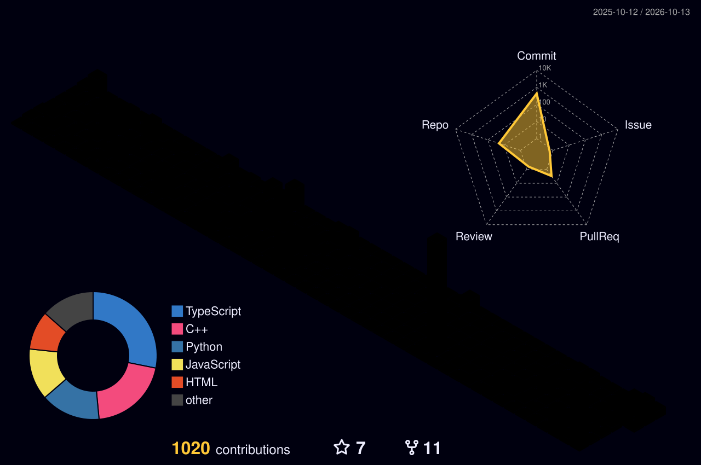

<!-- ═══════════════════════ HEADER ═══════════════════════ -->


<div align="center">

<a href="https://github.com/chayan2006">
  
</a>

<br/>


<br/><br/>

<a href="https://github.com/chayan2006"></a>
<a href="mailto:chayankhatua2006@gmail.com"></a>
<a href="https://www.linkedin.com/in/chayan-khatua-8880851bb/"></a>

</div>

<!-- ═══════════════════════ ABOUT ═══════════════════════ -->


##  About Me

<table>
<tr>
<td width="58%" valign="top">

```python
class ChayanKhatua:
    def __init__(self):
        self.role      = "AI/ML Developer · Full-Stack Engineer"
        self.education = "B.Tech CSE (AI & ML) @ LPU · 2025–2029"
        self.work      = ["Freelance Full-Stack @ Stream Bird India",
                          "ex-Business Analyst Intern @ Internwave Edtech"]
        self.building  = "Exoplanet detection — ISRO BAH 2025"
        self.wins      = ["🥇 FMS Hackathon 4.0 (Intl.)",
                          "🥇 IGNITE Hackathon 2025",
                          "🏅 Finalist — India Innovates 2026"]
        self.fun_fact  = "Shipped a client site to #1 on Google 🔝"

    def say_hi(self):
        return "Open to internships & collaborations ✨"
```

</td>
<td width="42%" valign="middle" align="center">


</td>
</tr>
</table>

<!-- ═══════════════════════ TECH STACK ═══════════════════════ -->
##  Tech Stack

<div align="center">


<br/>


<br/><br/>


**Certifications**


</div>

<!-- ═══════════════════════ PROJECTS ═══════════════════════ -->
##  Featured Projects

| | Project | What it does | Stack | Status |
|:-:|---|---|---|---|
| 🩺 | [**SehatAI**](https://github.com/chayan2006) | Triages your symptoms and tells you whether to see a doctor or handle it with self-care | Python · AI/ML |  |
| 🩸 | [**Blood Donation Matcher**](https://github.com/chayan2006) | Finds and messages nearby donors when a hospital urgently needs blood | Python |  |
| 📧 | [**AI Email Auto-Draft Responder**](https://github.com/chayan2006) | Drafts Gmail replies with a local LLM — nothing leaves your machine | Gmail API · OAuth 2.0 · Ollama (Phi-3) |  |
| 🧘 | [**Productive Life OS**](https://github.com/chayan2006) | Productivity app built on Kaizen, Ikigai, 5S, Hansei & Shoshin | React · TypeScript · Zustand |  |
| 🛰️ | [**Exoplanet Detection**](https://github.com/chayan2006) | Detects exoplanets from light-curve data for ISRO's Bharatiya Antariksh Hackathon 2025 | PyTorch |  |

<!-- ═══════════════════════ ACHIEVEMENTS ═══════════════════════ -->
##  Hackathons & Recognition

<div align="center">


<br/>


<br/><br/>


</div>

<!-- ═══════════════════════ GITHUB STATS ═══════════════════════ -->
##  GitHub Analytics

<div align="center">

<!-- 3D contribution calendar (generated daily by .github/workflows/profile-3d.yml) -->


<br/>


</div>

<!-- ═══════════════════════ EXPLORING ═══════════════════════ -->
##  Currently Exploring

- 📚 Sharpening CS fundamentals — data structures, algorithms, discrete math
- 🔬 Research direction: wearable cardiac-emergency detection (Healthcare AI)
- 🤝 Applying to MLH Fellowship (Fall 2026) & GSSoC 2026
- 🧠 Long-term: agentic AI systems

<!-- ═══════════════════════ SNAKE ═══════════════════════ -->
<div align="center">

<picture>
  <source media="(prefers-color-scheme: dark)" srcset="https://raw.githubusercontent.com/chayan2006/chayan2006/output/github-snake-dark.svg" />
  <source media="(prefers-color-scheme: light)" srcset="https://raw.githubusercontent.com/chayan2006/chayan2006/output/github-snake.svg" />
  
</picture>

</div>

<!-- ═══════════════════════ CONNECT ═══════════════════════ -->
<div align="center">

### 📫 Let's build something together

<a href="mailto:chayankhatua2006@gmail.com"></a>
<a href="https://www.linkedin.com/in/chayan-khatua-8880851bb/"></a>


</div>


